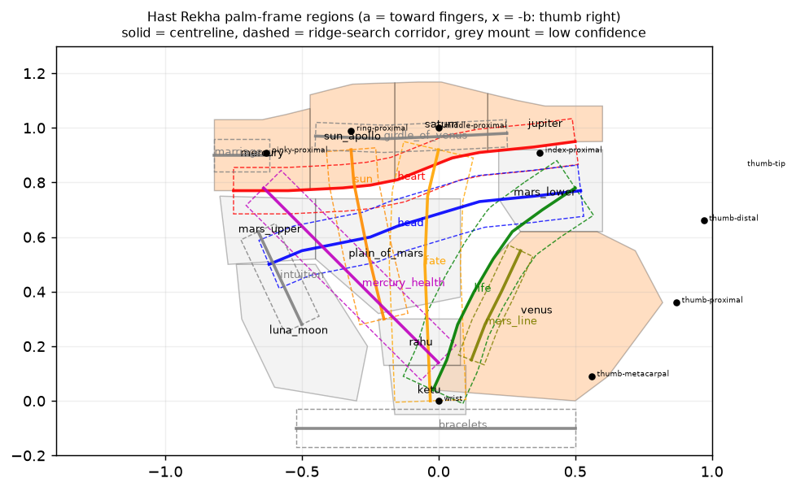
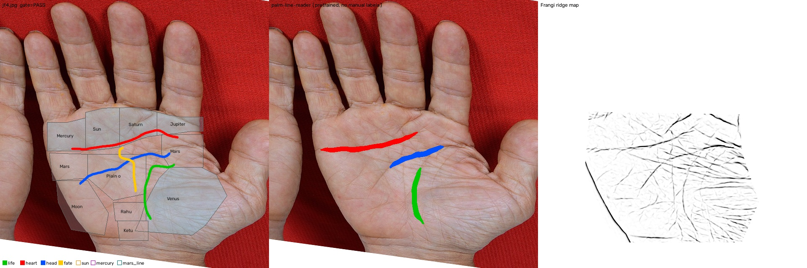
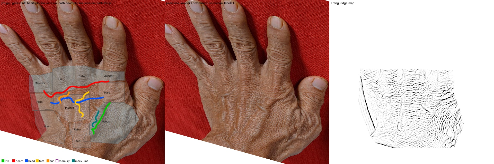

# Hast Rekha: automatic labelling of palm lines and mounts (no hand labelling)

**Goal:** label the major palm lines and the mounts on any hand, with no manual annotation, so the Quest app can place a reading on each region and so training data for a later line detector can be generated for free.

**Status:** a working Python prototype (`scripts/palm/autolabel.py`) plus a region file (`data/palm-regions.json`). The mount regions are deterministic and work from 4 hand joints. The line tracing works on clear, flat, well-lit palm photos and is gated so it rejects bad images. It is **not** validated against human-labelled ground truth (none exists); see Limitations.

## 1. The palm frame ("joint space")
Everything is defined in a frame built from four joints that exist in MediaPipe (2D camera) **and** WebXR/OpenXR hand tracking (Quest 3D):

```
q(a, b) = P[wrist] + a * (P[middle-finger-phalanx-proximal] - P[wrist]) + b * (P[pinky-finger-phalanx-proximal] - P[index-finger-phalanx-proximal])
```
`a=0` is the wrist, `a=1` the middle-finger knuckle; `b>0` is the pinky side and `b<0` the thumb side **for both hands** (the b-axis vector flips with the hand). In the headset, build the frame from the 3D joints, take the palm-plane normal as `cross(Ey, Ex)`, and draw each region as a planar polygon about 5 mm above the skin. Palm curvature is ignored. JS: `const O=j.wrist, Ey=sub(j.mid,O), Ex=sub(j.pinky,j.index); const q=(a,b)=>add(O,add(mul(Ey,a),mul(Ex,b)));`



## 2. Regions
Mount polygons were laid out from anatomy (Cheiro and Benham locations, see `research/palmistry-rulebook.md`) in this frame, then checked against 150 palmar photos. The low-confidence ones (Rahu/Ketu, which come only from modern Indian guides, and any mount without clear landmarks) are marked as such.

| Mount | Hindi | Confidence | Centroid (a,b) |
|---|---|---|---|
| jupiter | गुरु पर्वत (Guru Parvat) | high | [1.014, -0.39] |
| saturn | शनि पर्वत (Shani Parvat) | high | [1.011, -0.01] |
| sun_apollo | सूर्य पर्वत (Surya Parvat) | high | [0.969, 0.315] |
| mercury | बुध पर्वत (Budh Parvat) | high | [0.906, 0.645] |
| mars_upper | मंगल पर्वत (ऊपरी) (Mangal Parvat (upper)) | medium | [0.627, 0.618] |
| mars_lower | मंगल पर्वत (निचला) (Mangal Parvat (lower)) | medium | [0.764, -0.388] |
| plain_of_mars | मंगल क्षेत्र (Mangal Kshetra) | medium | [0.54, 0.192] |
| luna_moon | चंद्र पर्वत (Chandra Parvat) | medium | [0.258, 0.512] |
| venus | शुक्र पर्वत (Shukra Parvat) | high | [0.33, -0.359] |
| rahu | राहु पर्वत (Rahu Parvat) | low | [0.215, 0.065] |
| ketu | केतु पर्वत (Ketu Parvat) | low | [0.04, 0.035] |

Each line has a **centreline**, a **search corridor** and **start/end anchor regions**. For heart, head and life the centrelines are the mean of palm-line-reader (a pretrained MIT-licensed model) output over 399 palms from the 11k Hands set, widened to 2-2.5 sd. The minor-line corridors are anatomy only.

| Line | Tier | Corridor half-width (palm-frame units) | Start | End |
|---|---|---|---|---|
| heart | major | 0.085 | ulnar edge below the little finger | under Jupiter (index) base, between Jupiter and Saturn, under Saturn (middle) base |
| head | major | 0.095 | radial edge, between thumb and index (alone or joined to life line) | straight: ulnar edge under Mars, sloping: Moon mount |
| life | major | 0.12 | radial edge between thumb and index, above the thumb web | wrist-side base of the thenar (Venus) mount |
| fate | major | 0.13 | wrist centre / life line / Moon mount / mid-palm (varies) | Saturn mount base |
| sun | minor | 0.09 | anywhere in lower palm / Moon / life / fate / head / heart | Sun (ring) mount base |
| mercury_health | minor | 0.09 | base of Mercury (little finger) mount | toward life line / wrist |
| marriage | minor | 0.06 | ulnar edge | short, horizontal, between heart line and Mercury finger base |
| bracelets | minor | 0.07 | wrist crease, radial | wrist crease, ulnar |
| girdle_of_venus | minor | 0.05 | between index and middle finger bases | between ring and little finger bases |
| mars_line | minor | 0.05 | lower Mars mount | inside the life line |
| intuition | minor | 0.07 | Mercury/Mars edge | Moon mount |

Ordering constraints used by the quality gate: heart line is distal (larger a) than head line at every b where both exist; head line is distal to life-line end; head line may share its first 0-1.5 cm with the life line (joined start); fate line, if present, crosses the head line and ends at/below the heart line unless it reaches the Saturn mount; mercury_health line must not be assigned the same pixels as life or fate lines; priority when corridors overlap: life > heart > head > fate > sun > mercury_health > minor.

## 3. Pipeline
**(a) Pseudo-labels (implemented).**
1. MediaPipe Tasks HandLandmarker gives 21 joints; map them to WebXR names; rectify the palm into a 640x640 canvas, fingers up, thumb on the right (`palm_frame.rectify`).
2. Ridge map: CLAHE on the LAB lightness channel, then a Frangi filter at sigma 1.5, 2.2 and 3.0, inside the palm mask.
3. Per line, in priority order life, heart, head, fate, sun, mercury_health, mars_line: a minimum-cost path through the corridor from the start anchor to the **farthest ridge-supported** end anchor (skimage `MCP_Geometric`; cost = 1/(0.02+ridge); pixels already claimed by an earlier line cost 25x, so lines can cross but not trace each other).
4. Independent second opinion: run palm-line-reader (UNet mit_b0, ONNX) on the same rectified image; it labels heart, head and life.
5. Optional third source: the Roboflow palm-line-segmentation dataset (CC BY 4.0, 46 images) can give extra pseudo-masks; it was **not downloaded or verified**.

**(b) Classification by corridor (implemented).** A traced path's class comes from the corridor it was found in; its end class comes from the end anchor it reached (e.g. heart: under Jupiter / between Jupiter and Saturn / under Saturn). Mount labels come from the polygons directly, with no image evidence needed.

**(c) Optional vision-LLM auto-labeller (designed, not run).** For the 40-50% of images that fail the gate, or for marks (island/star/cross/trident), send the rectified image with the corridor overlay to a vision LLM and ask only constrained questions ("does the heart line end under Jupiter, between, or under Saturn; is there a break; is there an island; return JSON"). Accept only answers that agree with (a) or add a mark inside a known polygon. The LLM never outputs coordinates, only a class inside the corridors, so a wrong answer is bounded. Cost and licensing of sending 11k Hands images to a hosted API were not evaluated (the dataset is academic-use only).

**(d) Quality filtering (implemented).** An image passes only if: the hand is palmar and detected; heart, head and life are each found; each has minimum mean ridge strength and length; `plr_on_path >= 0.6` (palm-line-reader agrees on at least 60% of the path); and heart is distal to head. Thresholds are in `autolabel.THR`.

## 4. Results (300 random 11k Hands palmar images, seed 33)
| Metric | Result |
|---|---|
| Hand landmarks detected | 300 / 300 |
| Passed the quality gate | **148 / 300 (49%)** |
| Heart / head / life found | 280 / 283 / 243 |
| Fate / mercury(health) / mars / sun found | 45 / 15 / 10 / 4 (these are mostly absent in photos at this resolution; counts are not accuracy) |
| Mean agreement with palm-line-reader on found paths (heart / head / life) | 0.92 / 0.95 / 0.80 |
| Most common reject reasons | life: plr line not on path (69), life not found (57), head plr line off (36), heart not found (20) |

Aggregate numbers: [`batch300-summary.json`](batch300-summary.json). Per-image outputs and overlays for 11k Hands images are **not committed** (the dataset's licence is academic use only).

Committed overlays use two CC BY-SA 4.0 Wikimedia Commons photos by Judgefloro (see ATTRIBUTION.md):
-   A clear palm: heart (red), head (blue), life (green) traced; fate (orange) found; mounts overlaid; middle panel palm-line-reader; right panel ridge map.
-   A dorsal (back-of-hand) photo: correctly rejected by the gate.

**Reproduce:** `python scripts/palm/autolabel.py photo.jpg --out overlay.jpg`. Needs mediapipe (Tasks API, `hand_landmarker.task`), opencv, scikit-image, onnxruntime, shapely, and the palm-line-reader `student_fp32.onnx` weights (MIT; clone github.com/samuelwbarber/palm-line-reader). Paths via `HAND_TASK` and the defaults in `plr_infer.py`.

## 5. Limitations
- **No ground truth.** Agreement with palm-line-reader measures consistency between two automatic estimators, not correctness. A human spot-check of a few dozen overlays is still the only real accuracy test; I looked at a handful of overlays during development and the traced heart, head and life lines looked plausible on clear palms; this is anecdotal, not a measurement.
- **The gate is skewed.** Pass rate by skin-tone label in the dataset metadata: medium 100/176 (57%), fair 37/94 (39%), very fair 4/11, dark 7/19 (37%). Small groups, but lighter and darker skin both pass less often; the cause (contrast, lighting) was not investigated. If used to build training data this would bias it.
- **End classes are unreliable.** Head-line end is always classified "straight to Mars" (the sloping-to-Moon anchor is never chosen) and heart-line end splits ~50/50 between two classes. The farthest-supported-anchor rule is too crude; treat end classes as unvalidated.
- **Minor lines are weak.** Fate, sun, mercury and mars lines are faint; their detections have not been checked and probably include false positives. Marks (island, star, cross, trident, fish) are not detected at all; chain/break detection is a planned by-product of the path continuity score.
- **Rahu/Ketu mounts, the girdle of Venus, intuition and marriage lines** are anatomy-only placeholders.
- **2D photo vs headset.** The prototype runs on 2D photos. The regions are the part that transfers to Quest; the ridge tracing may not. Meta has a Passthrough Camera API for Quest 3/3S (Unity/Android), but I did not verify whether it is available on the WebXR/IWSDK path, and I did not test whether its resolution is enough for fine creases, so on-device line detection should be treated as unproven; see section 6 for a design that does not depend on it.
- MediaPipe's landmarks are 2D on spread, flat palms; real hands curl and tilt. Regions are population averages, not fitted to the person (palm width/length are normalised by the frame, but mount size varies).
- Population thresholds (finger length, palm squareness) are medians over 600 images and are relative by design.

## 6. What to do on Quest, with no manual labelling by the developer
1. **Mounts:** draw the polygons from section 2 on the open palm from the hand joints. This is fully automatic.
2. **Lines:** show the three major lines as translucent *template corridors* and let the user confirm or nudge them with a pinch (a game moment, not a labelling chore), or run the ridge tracing only on user-supplied photos (an optional "upload a palm photo" path in a companion web page).
3. **Readings:** drive the reading from the rulebook JSON using only the attributes that can be measured (finger lengths, palm squareness, thumb flexion, which corridor the user's confirmed line ends in).
4. **Training data** (if ever needed): run the batch pipeline on photos you are licensed to use and keep only gate-passing images.
